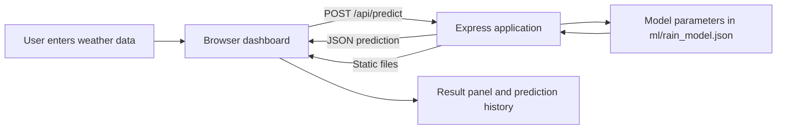

# Rainfall Prediction System

## Project Summary

Rainfall Prediction System is a web application that estimates whether rainfall is likely from weather conditions, month, and selected Indian city. It combines a browser dashboard, an Express API, and a trained logistic-regression classifier. The dashboard presents the predicted class, rainfall probability, estimated rainfall, confidence score, and a short history of results.

**Live application:** https://rainfallprediction-weld.vercel.app

> **Data note:** The model is trained on generated synthetic weather data, not measurements downloaded from a meteorological agency. Its test accuracy is measured on a synthetic holdout set and is not evidence of real-world forecasting accuracy.

## Problem Statement

Rainfall decisions affect travel, agriculture, outdoor work, and day-to-day planning. This project demonstrates how weather observations can be submitted to a machine-learning model and returned as an understandable prediction through a browser-based interface. It is an educational prototype and should not be used as an official weather warning or operational forecast.

## Objectives

- Accept common weather measurements and a city/month selection.
- Return a binary rainfall estimate with a probability and approximate rainfall amount.
- Present the result and supporting weather trends in a responsive dashboard.
- Keep model training separate from web serving by exporting the trained model to a JSON artifact.
- Deploy the browser app and prediction API together on Vercel.

## Main Features

- Automatic prediction on page load and after valid form edits; the Predict Rainfall button is also available.
- Inputs for location, month, temperature, humidity, pressure, wind speed, cloud cover, and previous rainfall.
- Prediction result with Rain/No Rain, probability, expected rainfall in millimeters, and confidence.
- Dashboard charts for monthly rainfall, temperature, and humidity.
- A recent-prediction list maintained in browser memory.
- Express endpoints for health checking and predictions.
- Responsive layout for desktop and mobile screens.

## Technology Stack

| Area | Technology |
| --- | --- |
| Frontend | HTML, CSS, browser JavaScript |
| Charts | Chart.js, loaded from jsDelivr CDN |
| Backend | Node.js and Express 4 |
| Model training | Python, pandas, scikit-learn |
| Classifier | StandardScaler + logistic regression |
| Hosting | Vercel Node.js function |

## Architecture and Request Flow



The browser reads the form values and sends them as JSON to `/api/predict`. Express loads the model artifact, normalizes the feature values using the stored scaler statistics, calculates a logistic-regression probability, and returns a JSON response. The browser updates the result panel and history from that response. On Vercel, `server.js` is exported as a Node function; `vercel.json` routes requests to it and includes the public assets and model artifact in the deployment.

## Project Structure

```text
rainfallprediction/
|-- ml/
|   |-- rain_model.json       # Trained model parameters and city/month factors
|   |-- train_model.py        # Synthetic data generation and model training
|   `-- weather_dataset.csv   # Generated training dataset
|-- public/
|   |-- index.html            # Dashboard markup and form
|   |-- script.js             # Charts, API requests, and UI updates
|   `-- styles.css            # Responsive dashboard styling
|-- server.js                 # Express API and static-file server
|-- vercel.json               # Vercel function and route configuration
|-- package.json              # Node dependencies and scripts
`-- README.md
```

## Weather Inputs

| Field | Meaning | Dashboard range |
| --- | --- | --- |
| `temperature` | Air temperature in degrees Celsius | -20 to 60 |
| `humidity` | Relative humidity percentage | 0 to 100 |
| `pressure` | Atmospheric pressure in hPa | 900 to 1100 |
| `windSpeed` | Wind speed in km/h | 0 to 120 |
| `cloudCover` | Cloud coverage percentage | 0 to 100 |
| `previousRainfall` | Previous rainfall amount in mm | 0 to 500 |
| `month` | Month number, January = 1 through December = 12 | 1 to 12 |
| `location` | Selected city name | One of the cities listed below |

Available locations are Mumbai, Pune, Nashik, Jalgaon, Delhi, Bengaluru, Ahmedabad, Kolkata, Hyderabad, Chennai, Jaipur, Lucknow, Kochi, and Goa. The `location` property is optional for direct API clients; the server defaults it to Mumbai.

The browser applies numeric input limits and only sends a prediction when the form is valid. The API checks that the required numeric fields are present; clients calling the API directly should also validate that their values are numeric and within sensible ranges.

## Dataset and Model Training

`ml/train_model.py` generates 5,000 synthetic rows using city profiles, seasonal temperature and humidity adjustments, and random variation. Each row includes the seven weather/month inputs, a city factor, a generated rainfall label, rainfall amount, and location. The labels are generated from a probability score that includes humidity, cloud cover, previous rainfall, city and month factors, and simple weather-condition rules.

The training script:

1. Writes the generated rows to `ml/weather_dataset.csv`.
2. Uses temperature, humidity, pressure, wind speed, cloud cover, previous rainfall, month, and city factor as model features.
3. Splits the data into 80% training and 20% test sets, stratified by rainfall label.
4. Fits a `StandardScaler` followed by `LogisticRegression` with balanced class weights.
5. Reports holdout accuracy and writes the scaler means/scales, model coefficients, intercept, city factors, and month factors to `ml/rain_model.json`.

The saved artifact currently reports **0.855 test accuracy**. Data generation uses random values without a fixed generation seed, so retraining can produce a different dataset and accuracy. Because the examples and labels are synthetic and derived from simplified assumptions, this score must not be interpreted as performance against observed weather data.

At prediction time, the application calculates a linear score from the standardized inputs and applies the sigmoid function to produce a probability. A probability of at least 0.5 is labeled `Rain`; otherwise the result is `No Rain`. The response probability is retained to six decimal places, while the dashboard displays it as a percentage to one decimal place. The expected rainfall amount is then estimated with a separate formula using probability, humidity, cloud cover, previous rainfall, and the selected month's rainfall factor. It is an estimate from this prototype, not a second trained regression model.

## Dashboard Notes

The prediction panel and history update using API responses. History is held in browser memory and is reset when the page is reloaded; the initial history entries are illustrative examples. The chart series in `public/script.js` are also fixed example monthly values. They are not retrieved from a live weather service, do not change with the selected city, and should be described as dashboard demonstrations rather than historical observations.

## API Reference

### `GET /api/health`

Returns service status.

```json
{
  "status": "ok",
  "message": "Rainfall Prediction API is running."
}
```

### `POST /api/predict`

Request content type: `application/json`

Example request:

```json
{
  "temperature": 27,
  "humidity": 84,
  "pressure": 1005,
  "windSpeed": 12,
  "cloudCover": 78,
  "previousRainfall": 8,
  "month": 7,
  "location": "Mumbai"
}
```

Example response from the deployed model:

```json
{
  "prediction": "Rain",
  "probability": 0.997572,
  "expectedRainfall": 94.7,
  "confidence": 1,
  "month": 7,
  "location": "Mumbai",
  "status": "Rain likely"
}
```

The `probability` is a number from 0 to 1; multiply it by 100 for a percentage. The `confidence` field is calculated from the distance of the probability from the 0.5 decision threshold; it is not a separately calibrated confidence interval.

For missing required fields, the API returns HTTP 400 with an `error` and `details` array. Unexpected prediction errors return HTTP 500 with an error description.

## Run Locally

Prerequisites: Node.js and npm. From the project root:

```bash
npm install
npm start
```

Open `http://localhost:3000`. Keep the terminal running while using the local site. For automatic server restarts during development, run:

```bash
npm run dev
```

## Retrain the Model

Python is only needed to regenerate the dataset and model. From the project root, create and activate a virtual environment, then install the training dependencies:

```powershell
py -m venv .venv
.\.venv\Scripts\Activate.ps1
python -m pip install pandas scikit-learn
python ml/train_model.py
```

Training replaces `ml/weather_dataset.csv` and `ml/rain_model.json`. Restart the Node server after retraining so it loads the updated model artifact.

## Vercel Deployment

The current production deployment is available at:

**https://rainfallprediction-weld.vercel.app**

`vercel.json` configures `server.js` as an `@vercel/node` function, includes `public/**` and `ml/rain_model.json`, and routes incoming requests through Express. To deploy updates from an authenticated Vercel CLI in the project directory:

```bash
npx vercel login
npx vercel --prod
```

The `.vercel/` local project-link directory is excluded by `.gitignore`.

## Limitations and Future Work

- Replace generated synthetic training examples with a documented, quality-controlled historical weather dataset.
- Evaluate on temporally separated, real observations and report metrics such as precision, recall, F1 score, ROC-AUC, and calibration, in addition to accuracy.
- Calibrate probability estimates and validate performance separately by location and season.
- Add backend range/type validation and clearer API tests for invalid requests.
- Replace fixed dashboard chart values with data from a weather-data source and label the source and time period.
- Persist prediction history if users need it across browser sessions.
- Treat forecasts as advisory only until validated against operational weather data.

## License

No license file is currently included. Add a license before redistributing the project if you need to specify reuse terms.
